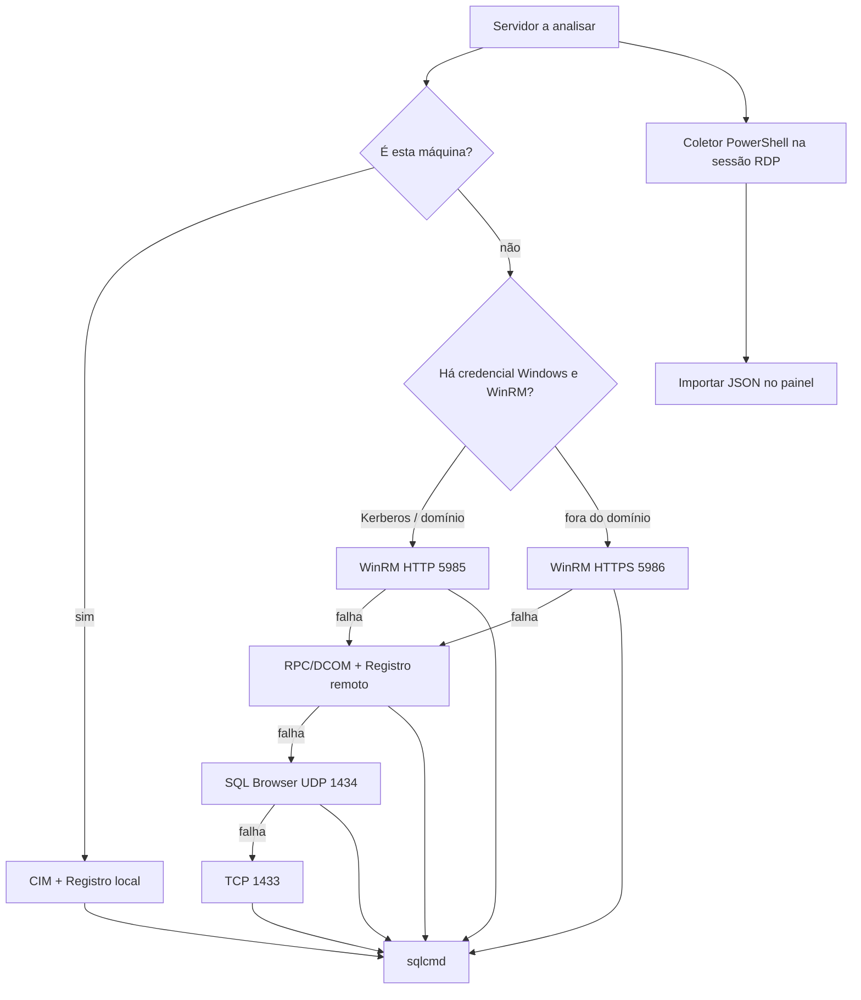

# Acesso remoto

O painel sempre escuta em `127.0.0.1`. O que muda é **como** ele alcança o Windows Server e as instâncias SQL. Escolha o caminho mais simples que a política do ambiente permitir.

## Visão dos caminhos



## 1. Máquina local

Informe `.`, `localhost`, `127.0.0.1` ou o hostname da estação. O PowerShell roda o coletor CIM/Registro **sem** `Invoke-Command`. A RAM é confirmada com `GlobalMemoryStatusEx`.

Autenticação SQL integrada usa a conta que iniciou o `start.bat`.

## 2. WinRM / Kerberos (mesmo domínio)

Requisitos típicos:

- WinRM habilitado no servidor (`Enable-PSRemoting`)
- porta TCP **5985** liberada
- a conta que executa o painel (ou a credencial informada) autorizada a criar sessão remota
- SPN e relógio razoavelmente sincronizados

No painel:

- **Inventário do Windows:** sessão atual **ou** credencial administrativa (`DOMINIO\usuario`)
- **Canal:** Automático / Kerberos (5985)
- **Conexão SQL:** integrada ou login SQL

Com credencial administrativa + autenticação Windows, o `sqlcmd` é disparado **dentro** do servidor (WinRM), contra `127.0.0.1` ou `.\INSTANCIA`. A identidade chega ao SQL Server no próprio host, sem delegação de credenciais.

## 3. WinRM HTTPS (máquina local fora do domínio)

Preparação **única**, como administrador, dentro do RDP do Windows Server. É necessário um certificado de computador:

- EKU **Server Authentication** (`1.3.6.1.5.5.7.3.1`)
- chave privada
- dentro da validade
- DNS do servidor no CN ou SAN

```powershell
.\Configure-SqlAdvisorWinRMHttps.ps1 -CertificateThumbprint 'THUMBPRINT_DO_CERTIFICADO'
```

O script:

1. Confere elevação e o certificado em `Cert:\LocalMachine\My`
2. Executa `Enable-PSRemoting -Force`
3. Cria o listener HTTPS na porta **5986** se ainda não existir (listeners existentes são preservados)
4. Cria a regra de firewall `SQL Server Advisor - WinRM HTTPS 5986` nos perfis Domain e Private, origem padrão `LocalSubnet`
5. Testa `Test-WSMan -UseSSL` localmente

Restringir à estação do DBA:

```powershell
.\Configure-SqlAdvisorWinRMHttps.ps1 -CertificateThumbprint 'THUMBPRINT' -AllowedRemoteAddress '10.20.30.40'
```

No painel, use o **nome DNS do certificado** (não o IP), credencial `DOMINIO\usuario` ou `SERVIDOR\Administrator`, e o canal **WinRM HTTPS (5986)**. A autoridade emissora precisa ser confiável na máquina do painel.

Em grupo de trabalho o Windows restringe contas administrativas locais comuns (UAC remoto). Prefira a conta interna `SERVIDOR\Administrator`. O configurador **não** desativa as proteções remotas do UAC.

## 4. RPC/DCOM (fallback automático)

Se o WinRM falhar, `discovery.py` tenta `New-CimSession -Protocol Dcom` e `OpenRemoteBaseKey` no Registro remoto. Precisa do serviço **Remote Registry**, RPC e da mesma credencial administrativa.

Sucesso devolve inventário completo com aviso de que o WinRM estava indisponível. Falha segue para o SQL Browser.

## 5. SQL Browser e porta 1433

Sem inventário administrativo, o painel envia o byte `0x03` em UDP **1434** e interpreta a lista de instâncias (`InstanceName`, `tcp`).

Sem resposta, assume uma instância default na porta **1433**. Instâncias nomeadas em outras portas só aparecem com SQL Browser ativo ou com inventário Windows.

Nesse modo o hardware (RAM, CPU, memória livre) vem das DMVs, desde que o login SQL tenha `VIEW SERVER STATE` / `VIEW SERVER PERFORMANCE STATE`. Sem isso a análise aborta com HTTP 422.

Estado do serviço, modo de inicialização e instâncias com Browser desligado podem ficar incompletos.

## 6. Coletor RDP

Quando a política impede qualquer canal remoto, copie `Collect-SqlServerAdvisor.ps1` para o servidor, execute como administrador, traga o JSON e use **Importar diagnóstico JSON**. O FastAPI **não** chama WinRM nem `sqlcmd` nesse caminho.

Passo a passo e schema: [coletores.md](coletores.md).

## Credenciais no formulário

| Campo | Função |
| --- | --- |
| Inventário do Windows = sessão atual | Usa o token do processo Python |
| Inventário = credencial administrativa | `DOMINIO\usuario` ou `SERVIDOR\usuario`; senha vira `PSCredential` |
| Conexão SQL = integrada | `-E` no sqlcmd (local ou dentro do WinRM) |
| Conexão SQL = usuário SQL | `-U` + `SQLCMDPASSWORD` |
| Criptografar conexão | `sqlcmd -N` (ligado por padrão) |
| Confiar no certificado | `sqlcmd -C` quando a criptografia está ligada |

Senhas são obrigatórias em pares: Windows usuário+senha, SQL usuário+senha. O modelo Pydantic zera os campos opostos ao modo escolhido.

Login timeout padrão: **8 s** (3–30). Timeout do inventário PowerShell: **35 s** (DCOM limitado a 20 s).

## Permissões SQL úteis

| Permissão | Efeito |
| --- | --- |
| `CONNECT SQL` | Lê `SERVERPROPERTY` e `sys.configurations` |
| `VIEW SERVER STATE` / `VIEW SERVER PERFORMANCE STATE` | DMVs de memória, NUMA, cache, IFI, processo |
| Acesso ao `msdb` | Histórico de backup e `suspect_pages` |
| Ver `sys.databases` / `sys.master_files` | Opções e autogrowth dos bancos |

Sem as DMVs, o item correspondente aparece como “Não foi possível verificar” e uma nota de cobertura parcial lista o erro.

## Mensagens frequentes

O painel traduz ruído CLIXML/PowerShell em frases curtas (`clean_powershell_error` e `_clean_sqlcmd_error`):

| Sintoma | Interpretação |
| --- | --- |
| Erro de segurança desconhecido / unknown security error | WinRM/Kerberos recusou a autenticação |
| Sessão de logon não existe | Credencial malformada ou necessidade de WinRM HTTPS fora do domínio |
| Acesso negado | Conta sem direito ao inventário remoto |
| Servidor RPC indisponível | DCOM/RPC bloqueado |
| Certificado do servidor / SSL | DNS do painel diferente do certificado, ou CA não confiável |
| Cannot connect to the destination | Listener ou firewall da porta 5985/5986 |
| Login failed | Usuário/senha SQL recusados |
| SSPI / security package | Integrada Windows recusada; use login SQL |
| Encryption not supported / SSL Provider | TLS incompatível; em rede confiável, desmarque a criptografia só para diagnóstico |
| Server is not found | Instância anunciada, TCP recusado na porta detectada |

## Checklist rápido

1. Mesmo domínio, conta já administrativa → sessão atual + Kerberos.
2. Estação fora do domínio → HTTPS 5986 + `SERVIDOR\Administrator` ou conta de domínio.
3. Política sem WinRM → coletor RDP.
4. Só há login SQL → inventário parcial + DMVs; conceda `VIEW SERVER STATE`.
5. Instância nomeada invisível → ligue o SQL Browser ou use inventário Windows / coletor.
