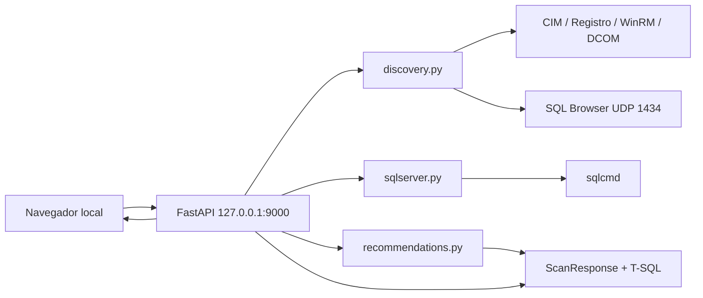
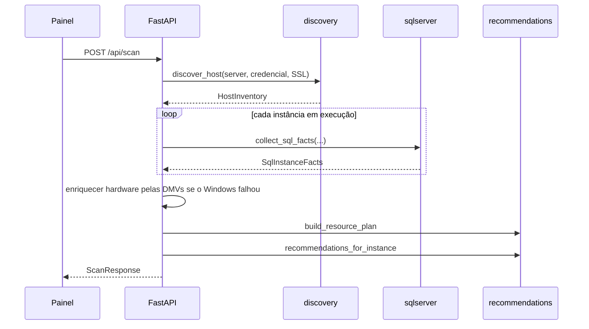
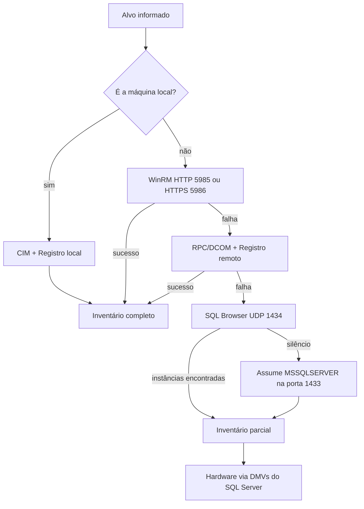

# Arquitetura

O SQL Server Advisor é um aplicativo FastAPI que roda apenas na máquina do DBA. A interface é um HTML estático servido em `http://127.0.0.1:9000`. Toda a lógica de inventário, coleta SQL e recomendação acontece no processo Python; o navegador só envia o formulário e renderiza o relatório.

Versão da API: **1.0.0** (`app/main.py`).

## Visão geral



Há dois caminhos de entrada:

| Rota | Origem dos dados |
| --- | --- |
| `POST /api/scan` | Descoberta ao vivo do Windows + `sqlcmd` em cada instância |
| `POST /api/import` | JSON gerado pelo coletor PowerShell dentro da sessão RDP |

Os dois caminhos convergem em `_analyze_inventory()`, que monta o orçamento, aplica as regras e devolve o mesmo `ScanResponse`.

## Módulos

| Arquivo | Responsabilidade |
| --- | --- |
| `app/main.py` | App FastAPI, middleware, rotas, orquestração da análise |
| `app/models.py` | Contratos Pydantic (`ScanRequest`, `ScanResponse`, snapshot v1) |
| `app/services/discovery.py` | Inventário do host e das instâncias |
| `app/services/sqlserver.py` | Coleta de fatos via `sqlcmd` (local ou via WinRM) |
| `app/services/recommendations.py` | Orçamento de RAM/CPU e catálogo de regras |
| `app/services/security.py` | Validação de hostname e redação de segredos |
| `app/static/app.js` | Formulário, importação JSON, renderização do relatório |
| `collector/*.ps1` | Coleta offline e habilitação do WinRM HTTPS |

Dependências de runtime (`requirements.txt`): FastAPI 0.115, Uvicorn, Jinja2. Não há driver ADO.NET/ODBC no Python: a coleta SQL é sempre `sqlcmd`.

## Fluxo de uma análise ao vivo



Detalhes de orquestração em `app/main.py`:

- Instâncias com serviço `stopped` / `not found` / `disabled` não disparam `sqlcmd`.
- Coletas SQL das instâncias ativas correm em paralelo (`asyncio.gather` + `asyncio.to_thread`).
- Se o Windows não informou RAM e as DMVs também não, a API responde **422**.
- `sql_process_memory_mb` das DMVs substitui o working set do serviço Windows quando disponível.
- Instância nomeada anunciada como `MSSQLSERVER` é corrigida pelo `SERVERPROPERTY('ServerName')`.

## Descoberta em cascata

`discover_host()` tenta o canal mais rico primeiro e degrada de forma previsível.



| Método (`discovery_method`) | Origem | Completude |
| --- | --- | --- |
| `windows-local` | CIM/WMI e Registro na própria máquina | Completa |
| `windows-winrm` | `Invoke-Command` no alvo | Completa |
| `windows-dcom` | `New-CimSession -Protocol Dcom` + `OpenRemoteBaseKey` | Completa, com aviso de WinRM |
| `sql-browser` | Resposta UDP do SQL Browser | Instâncias e portas; hardware vem das DMVs |
| `sql-default-port` | Palpite TCP 1433 | Uma instância default; hardware vem das DMVs |
| `rdp-snapshot` | JSON importado | Completa no momento da coleta no servidor |

Inventário Windows completo inclui: caption e versão do SO, RAM total e livre, CPUs lógicas, nomes das instâncias, `instance_id` do Registro, estado e modo de inicialização do serviço, porta TCP estática/dinâmica e working set do processo `sqlservr`.

Quando o alvo é local, a RAM é confirmada com `GlobalMemoryStatusEx` e o número de CPUs com `os.cpu_count()`, para não depender só do CIM.

Alvos considerados locais: `.`, `localhost`, `127.0.0.1`, `::1`, hostname e FQDN da máquina.

## Coleta SQL

A consulta em `app/services/sqlserver.py` (`_BASE_QUERY`) é a mesma usada pelo coletor PowerShell. Três blocos `TRY/CATCH` isolam falhas de permissão:

1. **Configurações públicas** — `SERVERPROPERTY` e `sys.configurations`, arquivos do tempdb.
2. **Métricas de host e cache** — `sys.dm_os_sys_info`, `sys.dm_os_sys_memory`, `sys.dm_os_process_memory`, `sys.dm_os_schedulers`, `sys.dm_exec_cached_plans`, `sys.dm_server_services`. Erro vira `host_metrics_error`.
3. **Bancos de usuário** — `sys.databases` e `sys.master_files` (id > 4). Erro vira `database_metrics_error`.
4. **Operação** — histórico em `msdb.dbo.backupset` e `msdb.dbo.suspect_pages`. Erro vira `operational_metrics_error`.

O endpoint de conexão prefere a porta detectada no Registro (`tcp:host,porta`). Sem porta, usa `host` para a instância default e `host\NOME` para instâncias nomeadas.

Com **autenticação Windows remota** e credencial administrativa, o `sqlcmd` roda **dentro do servidor** via WinRM, contra `127.0.0.1` ou `.\INSTANCIA`. Isso evita a delegação Kerberos (double-hop). Com **login SQL**, a consulta vai direto da máquina do painel ao endpoint TCP, mesmo que uma credencial Windows tenha sido informada para o inventário.

## Orçamento de recursos

Implementado em `build_resource_plan()`.

### Memória

```
total_mb                 = max(RAM física, 2048)
reserva_solicitada       = max(reserva_gb × 1024, ceil(total_mb × percentual / 100))
working_set_sql          = soma dos process_memory_mb das instâncias
não_sql_observado        = max(0, total_mb − RAM livre − working_set_sql)
reserva_serviços_ativos  = não_sql_observado + max(1024, ceil(total_mb × 0.05))
reserva_solicitada       = max(reserva_solicitada, reserva_serviços_ativos)
mínimo_sql               = min(2048, max(512, total_mb / 3))
reservado                = min(reserva_solicitada, max(512, total_mb − mínimo_sql))
orçamento_sql            = floor((total_mb − reservado) / 256) × 256   (piso 256 MB)
```

A última linha arredonda para baixo em blocos de 256 MB.

A divisão entre instâncias usa peso `max(1024, process_memory_mb)`. A última instância recebe o restante, cada parcela tem piso de 256 MB, e a soma coincide com o orçamento.

### CPU

```
reserva_cpu = valor informado, ou ceil(lógicos × 0.20) com mínimo 1
reserva_cpu = min(reserva_cpu, lógicos − 1)     # sempre sobra ao menos 1 para o SQL
orçamento_sql_cpu = lógicos − reserva_cpu
```

O orçamento de CPU é dividido de forma quase igual entre as instâncias (`divmod`). Esse número alimenta o cálculo de MAXDOP; **não** configura affinity mask.

### Alertas de orçamento

Gerados em `_analyze_inventory()`:

- orçamento SQL menor que 2 GB por instância
- RAM livre atual menor que metade da reserva planejada
- instância em execução que recusou a conexão SQL

## MAXDOP

`recommended_maxdop(cpu_share, numa_node_count, schedulers_per_numa)` segue a orientação da Microsoft (KB 2806535 / documentação de MAXDOP):

| Topologia | Teto |
| --- | --- |
| 1 nó NUMA e ≤ 8 schedulers visíveis no nó | usar todos |
| 1 nó NUMA e > 8 schedulers | 8 |
| Vários nós e ≤ 16 schedulers por nó | usar os visíveis no nó |
| Vários nós e > 16 schedulers por nó | `min(16, visíveis / 2)` |

O valor final é `min(parcela_de_cpu, teto_numa)`. Parcelas de 1 ou 2 CPUs geram MAXDOP **1**.

O tempdb **não** usa a parcela de CPU: o alvo inicial é `min(8, CPUs lógicas visíveis ao host)`. Arquivos já existentes acima desse alvo são preservados; o script nunca emite `REMOVE FILE`.

## Painel

`app/static/app.js` envia JSON para `/api/scan` ou `/api/import`, limpa os campos de senha, e desenha:

- grade de métricas do host
- avisos
- cartão por instância (estado do serviço, edição, versão, tabela de regras)
- botão de copiar T-SQL (Clipboard API)
- metodologia usada no cálculo

Importação JSON rejeita arquivos maiores que **2 MB** no navegador. O modelo Pydantic limita o snapshot a 64 instâncias e 100 pares de configuração por instância.
